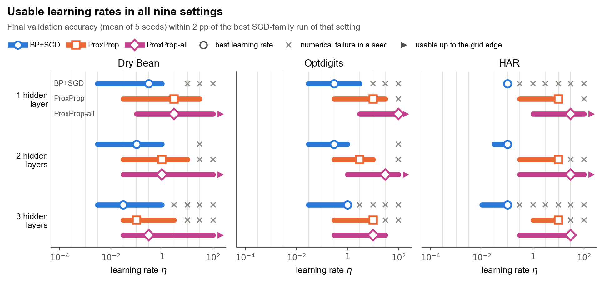
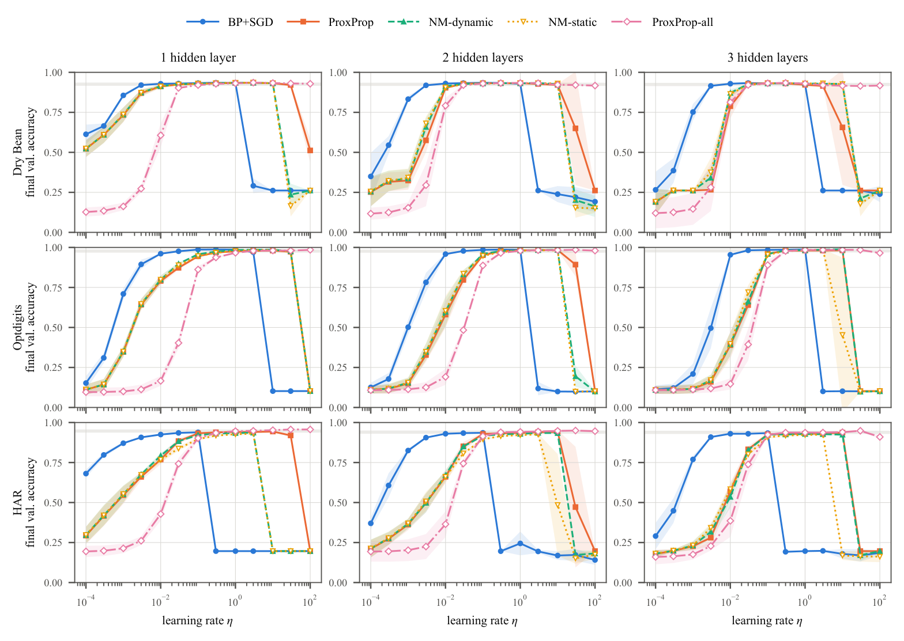
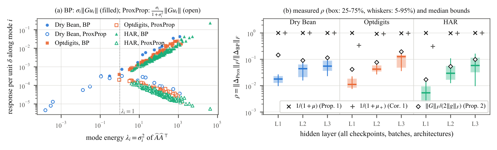
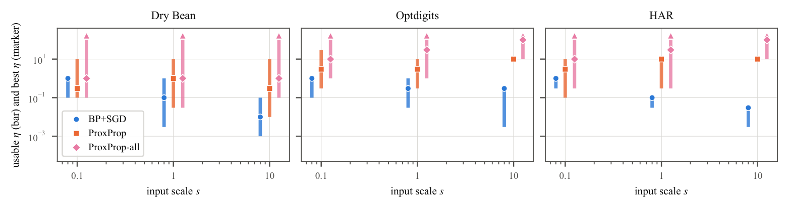
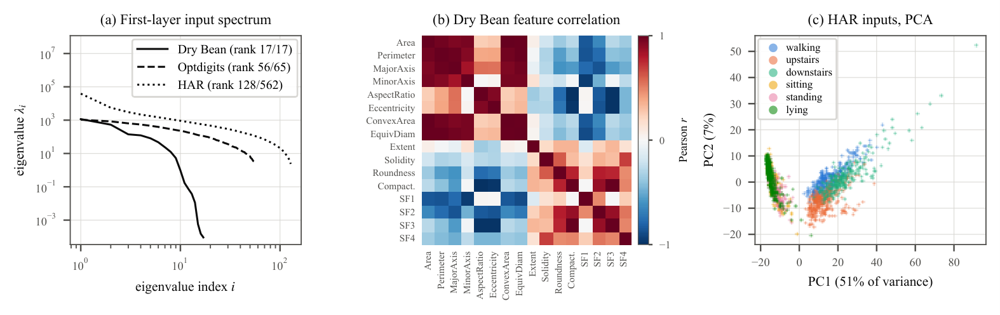

<div align="center">

# Learning-Rate Sensitivity of Backpropagation

### A One-Step Bound and an Empirical Study of Proximal Updates

[**Zekai Yu**](https://github.com/fantasy-creator)<sup>\*</sup> &nbsp;·&nbsp;
[**Tingshuo Fan**](https://github.com/Survivor613)<sup>\*</sup> &nbsp;·&nbsp;
[**Jiacheng Chen**](https://github.com/eliiiii05)<sup>\*</sup>

University of California, Davis &nbsp;·&nbsp; ECS 171 Machine Learning, final project<br>
<sup>\*</sup>Equal contribution

[](https://doi.org/10.1038/323533a0)
[](https://arxiv.org/abs/1706.04638)




<p><em>Each bar joins the learning rates at which a method trains well: final validation accuracy within 2 points of the
best SGD-family run of that setting. ProxProp moves the bar to larger learning rates. ProxProp-all, which also applies
the proximal update to the output layer, widens it and never fails numerically.</em></p>

</div>

## TL;DR

Proximal Backpropagation (ProxProp) keeps backpropagation's backward pass but replaces each hidden layer's gradient
step with a proximal step, and it has been reported to tolerate much larger learning rates. We ask whether it
**widens** the range of learning rates that train well or only **moves** it. Mostly it moves it: the range shifts up
by half a decade to two decades and gets wider in only 3 of 9 settings. Extending the proximal update to the output
layer, the one layer our bound shows is left undamped, removes every numerical failure, widens the range in 8 of 9
settings and raises test accuracy on HAR by 1.1 to 1.9 points.

## Highlights

- **A one-step bound.** From a fixed state, changing the learning rate from $\eta$ to $\eta+\delta$ moves BP's update
  by exactly $|\delta|\,\Vert g\Vert_F$ and ProxProp's by at most $|\delta|\,\Vert g\Vert_F/(1+\mu)$, where $\mu$ is
  the smallest eigenvalue of the layer's input second-moment matrix. A mode-wise bound, $|\delta|\,\Vert G\Vert_F/2$,
  does not depend on the input scale.
- **The bounds hold.** None is violated in 1,260 layer-level checks, and the scale-free bound is the tightest in every
  check, a median factor of 2.5 above the measured response.
- **Shift, not widen.** ProxProp moves the usable learning-rate range up by 0.5 to 2 decades. It is wider than BP's in
  3 of 9 settings, as wide in 5 and narrower in 1.
- **Fix the undamped layer.** ProxProp-all has no numerical failures in 585 runs (BP+SGD: 101, ProxProp: 62), a wider
  range than BP in 8 of 9 settings, and 1.1 to 1.9 points higher test accuracy than BP+SGD on HAR (Holm-adjusted
  *p* < 0.05), at 2.6 to 2.7 times BP's cost per step.
- **One learning rate for everything.** A single rate is usable in all 9 settings: 0.1 for BP+SGD, 1 or 3 for
  ProxProp, and 3, 10 or 30 for ProxProp-all.

## Method

All update rules share BP's forward and backward pass and differ only in how the gradient $g$ of a layer becomes a
step. For a layer with input batch $\hat A$ (one column per sample, plus a row of ones for the bias):

$$
\text{BP+SGD:}\quad W \leftarrow W - \eta\, g
\qquad\qquad
\text{ProxProp:}\quad W \leftarrow W - \eta\, g\, M^{-1},\qquad M = \hat A \hat A^{\top} + \tau_\theta^{-1} I
$$

We use $\tau_\theta = 1$. The proximal step solves this small linear system per layer, exactly, by a Cholesky
factorization. Two controls give SGD
ProxProp's step length but keep BP's direction, which separates the effect of smaller steps from that of the
preconditioned direction.

| Method | Hidden layers | Output layer | Role |
| --- | --- | --- | --- |
| BP+SGD | $-\eta\, g$ | $-\eta\, g$ | baseline, Eq. 8 of Rumelhart et al. (1986) |
| ProxProp | $-\eta\, g M^{-1}$ | $-\eta\, g$ | Frerix et al. (2018) |
| ProxProp-all | $-\eta\, g M^{-1}$ | $-\eta\, g M^{-1}$ | proximal update on every layer |
| NM-static | $-\eta\, c_l\, g$ | $-\eta\, g$ | ProxProp's step length, measured at initialization |
| NM-dynamic | $-\eta\, s_l(t)\, g$ | $-\eta\, g$ | ProxProp's step length, recomputed every step |
| BP+Adam | Adam | Adam | reference |

## Results

### Learning-rate sweeps

<p align="center"></p>

Final validation accuracy against the learning rate (mean ± standard deviation over 5 seeds, 13 learning rates from
$10^{-4}$ to $100$). The gray band marks accuracies within 2 points of the best SGD-family run.

### Test accuracy

<table align="center">
<thead>
<tr><th rowspan="2">Method</th><th colspan="3">Dry Bean</th><th colspan="3">Optdigits</th><th colspan="3">HAR</th></tr>
<tr><th>1</th><th>2</th><th>3</th><th>1</th><th>2</th><th>3</th><th>1</th><th>2</th><th>3</th></tr>
</thead>
<tbody>
<tr><td>BP+SGD</td><td>93.1</td><td>93.2</td><td>93.1</td><td><b>96.2</b></td><td>96.3</td><td>96.2</td><td>94.3</td><td>94.5</td><td>94.4</td></tr>
<tr><td>ProxProp</td><td>93.1</td><td>93.0</td><td><b>93.3</b></td><td>95.6</td><td>96.1</td><td>96.7</td><td>95.1</td><td>94.8</td><td>94.2</td></tr>
<tr><td>ProxProp-all</td><td><b>93.3</b></td><td><b>93.4</b></td><td><b>93.3</b></td><td><b>96.2</b></td><td><b>96.9</b>&dagger;</td><td><b>97.0</b></td><td><b>96.2</b>&dagger;</td><td><b>96.1</b>&dagger;</td><td><b>95.5</b>&dagger;</td></tr>
<tr><td>NM-dynamic</td><td>93.0</td><td>92.9</td><td>93.1</td><td>95.9</td><td>96.2</td><td>96.2</td><td>94.6</td><td>94.4</td><td>94.1</td></tr>
<tr><td>NM-static</td><td>93.0</td><td>92.9</td><td>93.0</td><td>95.6</td><td>96.0</td><td>96.0</td><td>94.3</td><td>94.0</td><td>93.9</td></tr>
<tr><td>BP+Adam</td><td>93.0</td><td>93.0</td><td>93.1</td><td><b>96.2</b></td><td>96.5</td><td>96.4</td><td>94.4</td><td>94.5</td><td>94.3</td></tr>
<tr><td>Logistic regression</td><td colspan="3" align="center">92.0</td><td colspan="3" align="center">95.2</td><td colspan="3" align="center">95.2</td></tr>
</tbody>
</table>

Test accuracy (%, mean of 5 seeds) at each method's validation-selected learning rate, for 1, 2 and 3 hidden layers.
Bold: best network in the column. &dagger;: better than BP+SGD after Holm correction (paired *t*-tests over the 5
seeds, 27 comparisons with BP+SGD, *p* < 0.05).

### Checking the bound

<p align="center"></p>

(a) Response of each input mode to a learning-rate change in the first hidden layer at initialization: BP (filled)
grows with the mode's energy, ProxProp (open) is damped on strong modes. (b) Measured ratio of ProxProp's response to
BP's in every hidden layer, against the median of each bound. No check violates a bound.

<details>
<summary><b>More results: input scale and datasets</b></summary>
<br>

<p align="center"></p>

Usable learning rates (bars) and the best learning rate (markers) when every input is multiplied by
$s \in \{0.1, 1, 10\}$, for networks with 2 hidden layers. Triangles mark windows that reach the top of the grid.
$s = 1$ is the main sweep (5 seeds), the other scales use 3 seeds.

<p align="center"></p>

(a) Eigenvalues of the first layer's input second-moment matrix for a standardized mini-batch of 128 (median of 10
batches). (b) Feature correlation in Dry Bean. (c) First two principal components of the HAR training inputs.

</details>

## Getting started

### Installation

```bash
git clone https://github.com/fantasy-creator/Learning-Rate-Sensitivity-of-Backpropagation.git
cd Learning-Rate-Sensitivity-of-Backpropagation
python -m venv .venv && source .venv/bin/activate
pip install -r requirements.txt
```

### Data

The three datasets come from the UCI Machine Learning Repository and are not stored here. Download them and unpack
them under `data/raw` so that these paths exist:

| Dataset | Features | Classes | Train / val / test | Paths under `data/raw` |
| --- | ---: | ---: | --- | --- |
| [Dry Bean](https://archive.ics.uci.edu/dataset/602/dry+bean+dataset) | 16 | 7 | 9,479 / 2,034 / 2,030 | `drybean/DryBeanDataset/Dry_Bean_Dataset.arff` |
| [Optdigits](https://archive.ics.uci.edu/dataset/80/optical+recognition+of+handwritten+digits) | 64 | 10 | 3,060 / 763 / 1,797 | `optdigits/optdigits.tra`, `optdigits/optdigits.tes` |
| [HAR](https://archive.ics.uci.edu/dataset/240/human+activity+recognition+using+smartphones) | 561 | 6 | 5,886 / 1,466 / 2,947 | `har/UCI HAR Dataset/` (a zip inside the download) |

Then build the fixed splits:

```bash
python src/data_prep.py --raw data/raw --out data/processed
```

### Running

```bash
python src/test_core.py     # correctness checks for the update rules
SMOKE=1 bash run.sh         # unit tests plus 2-epoch runs of every method
bash run.sh                 # full pipeline
bash src/postprocess.sh     # analysis, tables and figures
```

`run.sh` reads `PYTHON` (default `python3`) and `WORKERS` (default 30, each a single-threaded run). It is CPU only by
design and skips finished work, so it can be restarted. Each worker needs a few hundred MB of memory. With 30 workers
the 3,510-run main sweep took about 24 minutes.

| Step | Runs | Output |
| --- | --- | --- |
| One-step bound checks | 1,260 layer records | `results/onestep/` |
| Main sweep | 3,510 | `results/main/` |
| Input-scale, momentum and $\tau_\theta$ ablations (3 seeds) | 702, 234, 234 | `results/{scale,momentum,tau}/` |
| Test stage at validation-selected learning rates | 270 | `results/test_main/` |
| Logistic-regression baseline, per-step cost | | `results/logreg.json`, `results/bench_step.json` |

`src/postprocess.sh` writes tables to `paper/tables/` and figures to `paper/figures/`. `src/fig_readme.py` draws the
figure at the top of this page.

## Repository structure

```
├── run.sh                      experiment pipeline
├── requirements.txt
├── assets/                     figures of this README
└── src/
    ├── core.py                 data loading, MLPs, update rules, training loop
    ├── data_prep.py            fixed train/validation/test splits
    ├── eda.py                  exploratory data analysis
    ├── test_core.py            correctness checks for the update rules
    ├── sweep.py                parallel experiment grids
    ├── onestep.py              one-step bound checks
    ├── dump_modes.py           per-mode responses
    ├── final_test.py           test-stage re-runs of the validation-selected configurations
    ├── logreg.py               logistic-regression baseline
    ├── bench_step.py           per-step cost
    ├── analyze.py              aggregation and paired tests
    ├── universal_lr.py         learning rates usable in every setting
    ├── make_tables.py          LaTeX tables: datasets and update rules
    ├── make_results_tables.py  LaTeX tables: results
    ├── fig_*.py                figures of the report
    └── postprocess.sh          analysis, tables and figures in one go
```

## Reproducibility

Everything runs in float64 on CPU, because ProxProp's smallest updates would be rounded away in float32. A seed fixes
the initialization and the mini-batch order, which all methods share. Every result stores the SHA-1 prefix of
`src/core.py` as `code_version`, and `src/sweep.py` only skips a run whose stored version matches the current file, so
editing `src/core.py` invalidates earlier results. The reported results have `code_version` `5d565f754e9a` and used
Python 3.10, PyTorch 2.3.0 and NumPy 1.24.4; other versions may give slightly different numbers. All 270 test-stage
re-runs reproduced their sweep's validation accuracy exactly.

## Citation

```bibtex
@misc{yu2026lrsensitivity,
  title        = {Learning-Rate Sensitivity of Backpropagation: A One-Step Bound and an Empirical Study of Proximal Updates},
  author       = {Yu, Zekai and Fan, Tingshuo and Chen, Jiacheng},
  year         = {2026},
  note         = {ECS 171 final project, University of California, Davis},
  howpublished = {\url{https://github.com/fantasy-creator/Learning-Rate-Sensitivity-of-Backpropagation}}
}
```

## Acknowledgments

This is the final project of ECS 171 (Machine Learning) at UC Davis, for which the assigned paper was Rumelhart,
Hinton and Williams (1986). It builds on:

- D. E. Rumelhart, G. E. Hinton and R. J. Williams. [Learning representations by back-propagating errors](https://doi.org/10.1038/323533a0). *Nature*, 323:533–536, 1986.
- T. Frerix, T. Möllenhoff, M. Moeller and D. Cremers. [Proximal Backpropagation](https://arxiv.org/abs/1706.04638). *ICLR*, 2018.
